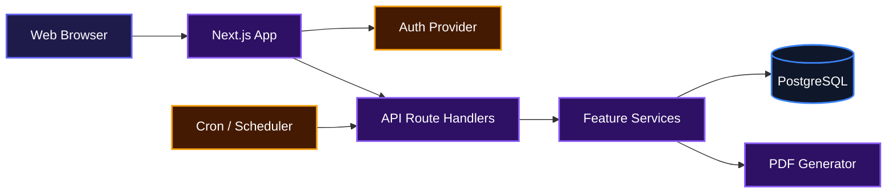
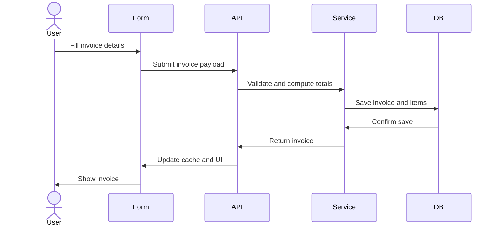
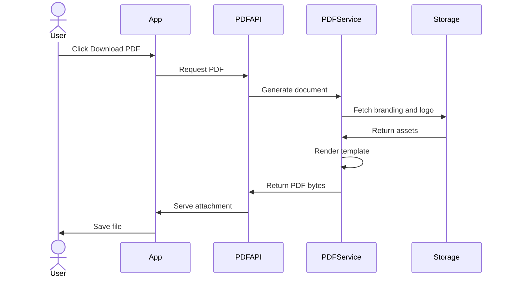
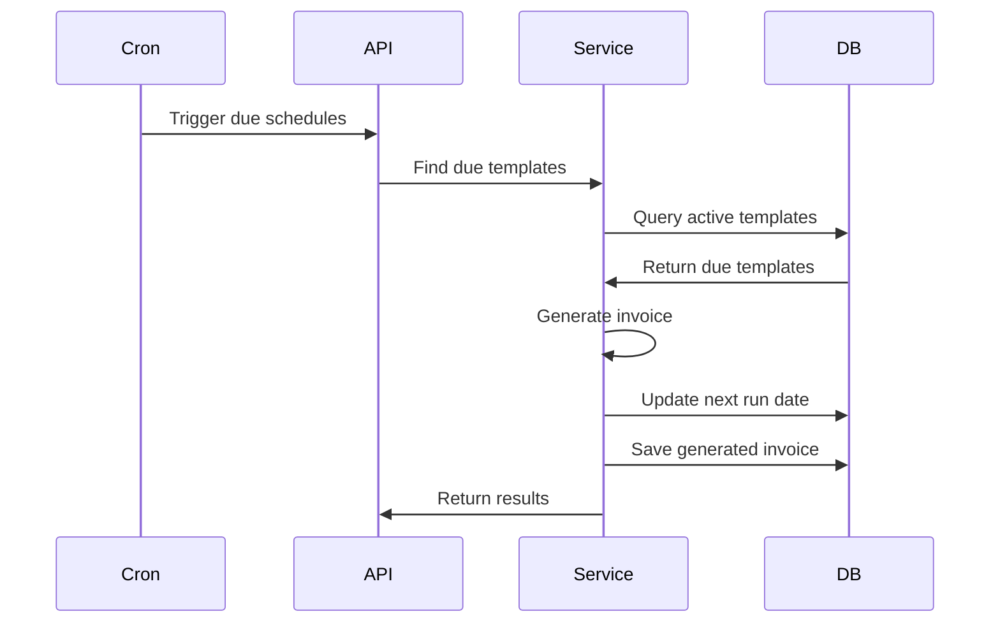

# BiteBill

BiteBill helps freelancers, consultants, and small businesses create professional invoices, track payments, and understand their revenue without juggling spreadsheets or separate tools. It is a full-stack invoicing application that brings client management, invoice generation, PDF exports, public sharing, recurring billing, and analytics into one clean workspace.

## Overview

BiteBill solves a common problem for solo professionals and small agencies: staying on top of who owes what, when payment is due, and how the business is performing. Users can onboard quickly, add clients, create branded invoices, and share payment links with customers. The dashboard turns raw invoice data into revenue trends and status breakdowns, while the analytics workspace gives deeper insights into client performance and outstanding balances.

The project is built with a strong focus on type safety, accessibility, and a polished user experience. Every invoice action is logged, totals are calculated on the server, and sensitive data is never exposed across user boundaries.

## System Architecture

BiteBill follows a modern layered architecture. The application serves the marketing site, protected dashboard, and API routes. Route handlers enforce authentication and delegate business logic to feature services backed by a PostgreSQL database.

## Features

### Invoice Management

Create, edit, and send invoices with itemized line entries, tax rates, discounts, and payment terms. Invoices move through statuses like draft, pending, paid, and overdue. All totals are computed on the server so clients cannot tamper with amounts.

### Branded PDF Generation

Generate print-ready PDFs from invoice data using custom branding, logos, and one of three templates: Classic, Modern, or Corporate. PDFs include line items, totals, payment terms, and status watermarks.

### Recurring Invoices

Set up monthly, quarterly, or yearly invoice schedules. BiteBill automatically generates invoices when the next run date arrives, and users can trigger ad-hoc generation at any time.

### Public Invoice Sharing

Share invoices with clients through secure, read-only links. Recipients can view the invoice and download the PDF without needing an account. Share links can have expiration dates, and view counts are tracked.

### Client Management

Keep a directory of clients with contact details, addresses, and notes. Each client page shows billing history, outstanding balances, and invoice health.

### Dashboard and Analytics

The dashboard provides a quick revenue snapshot, status distribution charts, recent invoices, and activity timelines. The analytics workspace adds revenue trends, accounts receivable aging, and a client performance leaderboard.

## Technologies Used

| Technology                                          | Purpose                    |
| --------------------------------------------------- | -------------------------- |
| [Next.js](https://nextjs.org/)                      | Full-stack React framework |
| [TypeScript](https://www.typescriptlang.org/)       | Type-safe JavaScript       |
| [Tailwind CSS](https://tailwindcss.com/)            | Utility-first styling      |
| [Neon PostgreSQL](https://neon.tech/)               | Serverless database        |
| [Drizzle ORM](https://orm.drizzle.team/)            | Database toolkit           |
| [Better Auth](https://www.better-auth.com/)         | Authentication             |
| [TanStack Query](https://tanstack.com/query/latest) | Server state management    |
| [Zustand](https://zustand.docs.pm/)                 | Client state management    |
| [React Hook Form](https://react-hook-form.com/)     | Form handling              |
| [Zod](https://zod.dev/)                             | Schema validation          |
| [Recharts](https://recharts.org/)                   | Data visualization         |
| [pdf-lib](https://pdf-lib.js.org/)                  | PDF generation             |
| [Framer Motion](https://www.framer.com/motion/)     | Animations                 |
| [date-fns](https://date-fns.org/)                   | Date utilities             |

## Author Info

Built by Emmanuel Ihemedu.

- [LinkedIn](https://linkedin.com/in/emmanuel-ihemedu)
- [X (Twitter)](https://x.com/deraamaobi)

